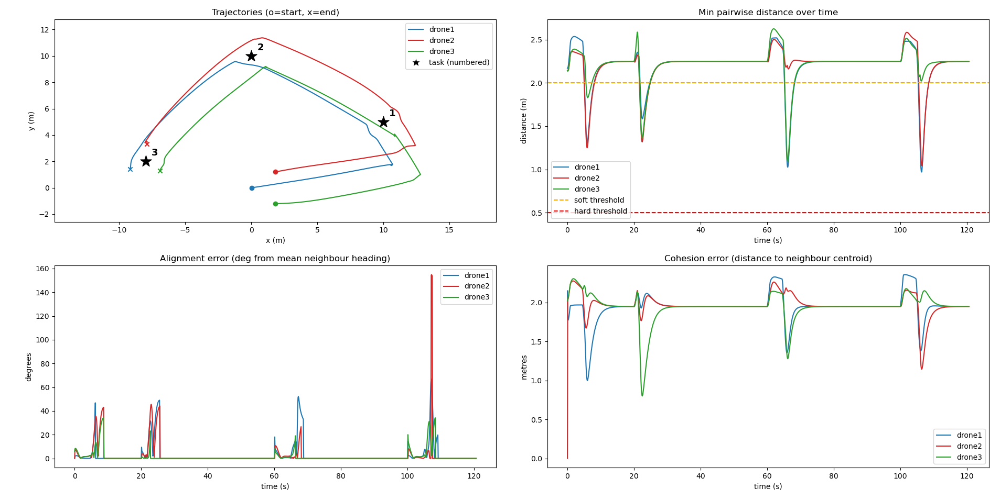

# Decentralized Multi-UAV Swarm Using ROS 2

A multi-agent UAV swarm simulation developed using ROS 2 Humble and Python. The project explores decentralized coordination, inter-agent communication, flocking, collision avoidance, and task allocation.

## Features

- Decentralized multi-agent coordination
- Inter-drone state and velocity communication
- Reynolds flocking (separation, alignment, and cohesion)
- Collision avoidance and minimum separation monitoring
- Dynamic task generation and goal following
- Preliminary CBBA-inspired bidding mechanism
- Trajectory visualization using Matplotlib

## Technologies

- Python
- ROS 2 Humble
- Ubuntu 22.04 / WSL2
- Matplotlib

## Installation and Execution

Clone the repository:

```bash
git clone https://github.com/hash-shaam/cbba_drone_swarm.git
cd cbba_drone_swarm
```

Build the workspace:

```bash
source /opt/ros/humble/setup.bash
colcon build
source install/setup.bash
```

Launch the swarm:

```bash
ros2 launch drone_agent swarm.launch.py
```

Run the task generator in a separate terminal:

```bash
source install/setup.bash
ros2 run task_generator task_generator
```

## Simulation Results



## Project Status

Developed as part of a research internship exploring Multi-Agent Systems (MAS) and autonomous UAV coordination. The current implementation demonstrates decentralized swarm behavior, with full CBBA-based task allocation remaining an area for future development.
